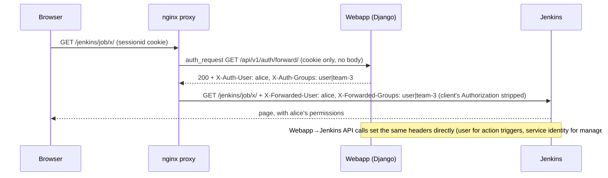

# Architecture

Contributor-facing overview of how the NITA webapp fits together. For install
and usage see [README.md](README.md); for image builds see [BUILD.md](BUILD.md).

## Request flow

Everything is served through a single NGINX endpoint on port 443.

```
                    ┌────────────────────────────────────────┐
   https://<host>/  │                NGINX                   │
   ─────────────────▶  (nginx/nginx.conf, TLS termination)   │
                    └───┬───────────────┬────────────────┬───┘
                        │               │                │
              /jenkins/ │               │ /api/v1/...    │ /  (+ SPA routes)
                        ▼               ▼                ▼
                  ┌──────────┐   ┌─────────────────────────────┐
                  │ Jenkins  │   │          Django             │
                  │  :8080   │   │  REST API  +  SPA index.html│
                  │ --prefix │   └──────────────┬──────────────┘
                  │ /jenkins │                  │
                  └──────────┘                  ▼
                                          ┌──────────┐
                                          │ MariaDB  │
                                          └──────────┘
```

Django serves the compiled SPA `index.html` for the root and an explicit
allowlist of client-side routes (`login`, `network-types`, `networks`, `users`,
`teams`, and their subpaths), so deep links and refreshes resolve correctly. All
other paths belong to the backend (`api/`, `admin/`, `assets/`, `jenkins/`,
`api/schema`, `api/docs`). Adding a new top-level SPA route means adding it to
that allowlist in `ngcn_workbench/urls.py` as well as to the React router.

Jenkins is **not** exposed on its own port. It runs with `--prefix=/jenkins` so
it emits correctly-prefixed URLs, and NGINX proxies `/jenkins/` to it. Backend
callers build Jenkins URLs from a single canonical prefixed base
(`jenkins_config.JENKINS_SERVER_URL`) — duplicating that string is what
previously caused action-history rows to stick at `Running`.

## Backend layout

```
build-and-test-webapp/nita-webapp/ngcn_workbench/
  ngcn_workbench/settings.py   settings, DRF + drf-spectacular config
  ngcn_workbench/urls.py       root routing, SPA fallback, token endpoint
  ngcn/models.py               User, Team, CampusType, CampusNetwork, Action, ...
  ngcn/api/urls.py             DefaultRouter under /api/v1/
  ngcn/api/views.py            viewsets and actions
  ngcn/api/serializers.py      serializers and field-level validation
  ngcn/api/permissions.py      role-based permission classes
  ngcn/api/schema_hooks.py     OpenAPI post-processing
  ngcn/jenkins_jobs.py         Jenkins invocation and log streaming
  tests/                       pytest suite
```

## Authentication

Two mechanisms share the same API:

- **Token** — `POST /api/v1/auth/token/` returns a DRF token for scripts/CLI,
  sent as `Authorization: Token <token>`.
- **Session** — the SPA uses `POST /api/v1/auth/login/` plus a CSRF token from
  `GET /api/v1/auth/csrf/`. `GET /api/v1/auth/me/` returns the caller's `role`
  and `teams`, which drives role-gated UI.

## Authorization

Access control is driven entirely by `User.role` (`user`, `power_user`,
`admin`). Django's `is_staff` / `is_superuser` flags gate the Django admin panel
only and are deliberately not consulted by the API.

Permission classes live in `ngcn/api/permissions.py`:

| Class | Grants |
|---|---|
| `IsAdminRole` | `role == admin` |
| `IsPowerUserOrAdmin` | `role in (power_user, admin)` |
| `IsOwnerOrAdmin` | object `owner`/`created_by` matches the caller, or admin |
| `IsOwnerOrTeamMemberOrAdmin` | networks: power_user/admin full; owner read+write; team member read-only |
| `IsAdminOrManagesNonAdminUser` | admin any user; power_user any **non-admin** user |

Viewsets select them per action via `get_permissions()`, and narrow the queryset
in `get_queryset()` (for example, a `power_user` listing users does not see
`admin` accounts). Two rules are enforced in view code rather than a permission
class because they depend on the request body or on aggregate state:

- a `power_user` may not set `role=admin`;
- an operation may not leave zero active administrators.

Destructive operations that would orphan or silently remove data return
`409 Conflict` with the blocking resources listed — deleting a user who still
owns networks/types, and deleting a network type still referenced by networks.

## API schema

`drf-spectacular` generates the OpenAPI document; `openapi.yaml` at the repo
root is committed and **must** be regenerated whenever the API surface changes:

```bash
cd build-and-test-webapp/nita-webapp/ngcn_workbench
DJANGO_SETTINGS_MODULE=ngcn_workbench.test_settings \
  python3 manage.py spectacular --file ../../../openapi.yaml
```

`tests/test_openapi_drift.py` fails if the committed file drifts from the live
schema. Post-processing hooks in `ngcn/api/schema_hooks.py` bound array sizes,
declare a document-level security requirement, and drop empty operation-level
`security` entries so the schema passes static analysis.

## Frontend

The SPA lives in `frontend/` and is built into the image by the Docker
`frontend-builder` stage. See [frontend/README.md](frontend/README.md) for its
structure and conventions.

## Testing and CI

```bash
pytest -q                      # backend suite (repo root)
cd frontend && npm run lint    # frontend lint (enforced in CI)
cd frontend && npm run build   # tsc -b && vite build
```

The pull-request workflow runs super-linter (Python Black plus legacy JS),
Microsoft Security DevOps, the Django pytest suite, the frontend ESLint gate,
and a container image build.

## Spec-driven workflow

Behaviour is specified before it is implemented. `openspec/specs/<capability>/`
holds the current requirements; a proposed change lives in
`openspec/changes/<name>/` (proposal, design, tasks, and spec deltas) and is
moved to `openspec/changes/archive/<date>-<name>/` once its deltas have been
merged back into the main specs. When changing behaviour, update the relevant
capability spec in the same change.

## How the SSO works

It's **header-based identity propagation**, not a shared login or OIDC. The webapp is the only identity provider; Jenkins has no user database and simply trusts two HTTP headers that only the proxy and the webapp pod can set. The trust boundary is the network, not a secret.



### The three layers

**1. Webapp — the identity source**
- `views.py:235` `forward_auth_view`: session-only (`LabSessionAuthentication`, no tokens), returns `200` with `X-Auth-User`, `X-Auth-Role`, `X-Auth-Groups`; otherwise `401/403`. Never touches the DB.
- `jenkins_config.py:41-58`: `jenkins_groups_for(user)` = `[role, team-<id>, …]`; `jenkins_identity_headers()` builds `X-Forwarded-User/Groups`; `_make_jenkins_server()` is a python-jenkins client with those headers and **no password**. `JENKINS_PASS` is unused.
- `jenkins_jobs.py:89` `invoke_job(..., initiated_by=user)`: action triggers act *as the user* (so Jenkins records `Started by user alice` and applies her job permissions); `initiated_by=None` runs as the `JENKINS_USER` service identity — used for `network_template_mgr` / `network_type_validator`, console/Robot relays, status polling, and the bootstrap scripts (`ping_jenkins.py`, `configure_jenkins.py`, `add_jenkins_job.py`).

**2. nginx — the gate and the courier** (`nginx.conf:46-65`)
- `auth_request /_auth/jenkins` (an `internal` location) on everything under `/jenkins/`; denial → `302 /login?next=<uri>`; `LoginPage` follows `next` only if it's a same-origin relative path.
- `auth_request_set` copies `X-Auth-User/Groups` into `X-Forwarded-User/Groups`, which **overrides anything the client sent**, and `Authorization` is blanked — so header spoofing from the browser is impossible.

**3. Jenkins — the consumer** (`basic-security.groovy:32-54`, seeded as `.override` so existing homes converge on every start)
- `ReverseProxySecurityRealm` in header mode (`reverse-proxy-auth-plugin`): username from `X-Forwarded-User`, groups from `X-Forwarded-Groups` (`|`-delimited); no header → anonymous. Password Basic auth → 401 (only API tokens would work).
- `ProjectMatrixAuthorizationStrategy` mirroring the webapp roles: `admin` → Administer; `power_user` → Read/Build/Cancel on all; `authenticated` → Overall/Read only; anonymous → nothing.
- Per-network grants come from the webapp: `network_template_mgr` (`network_template_mgr.xml:302`) writes an `AuthorizationMatrixProperty` into each generated job — owner **and** `team-<id>` get Read/Build/Cancel — on create, and `operation=acl` re-applies it when the team changes or ownership is transferred (`sync_network_acl`). Management jobs carry no per-job grants, so regular users can't reach them. Network *deletion* isn't a Jenkins permission at all — it's a webapp operation gated by `IsOwnerOrTeamMemberOrAdmin` (owner/power/admin only).
- CSRF stays on (`DefaultCrumbIssuer(true)`); the webapp fetches crumbs per request.

**Network enforcement** (`jenkins-network-policy.yaml`): Jenkins 8080 accepts ingress only from the proxy, webapp and Jenkins pods; the old `hostPort 8443` is gone. This is what makes trusting the headers safe — nothing else can reach Jenkins to assert an identity.

### Where it's specified
- `gate-jenkins-behind-webapp-session` — forward-auth contract (`auth`), proxy gate + header propagation (`jenkins-reverse-proxy`), attribution & per-network ACL mirror (`jenkins-trigger-security`), login `next`, sidebar shortcut.
- `let-team-members-operate-shared-networks` — team members operate but can't delete/re-share (and the `get_object()` fix for sub-actions).
- `revoke-anonymous-build-and-enable-csrf` — realm, project matrix, CSRF, `.override` seeding.
- `close-jenkins-direct-exposure` — 8443 removal + NetworkPolicy.

### Setup status
Fully deployed on this host and verified live (identity, groups, spoof resistance, attribution, per-network isolation, team edit/trigger vs. delete). All four changes pass `openspec validate --strict`. The code is **uncommitted** on the `jenkins-auth` branches in `nita`, `nita-webapp`, `nita-jenkins` (plus one new untracked change dir and `NetworksPage.test.tsx`), and the images are node-local only (`nita-webapp:jenkins-auth-team2`, `nita-jenkins:jenkins-auth-acl`), not on GHCR. Two caveats: the webapp generated a pending migration (`0008_…`) at startup that should be committed, and the host-installed `/usr/local/bin/nita-cmd_*` symlinks still point at the old scripts (needs root to refresh).
